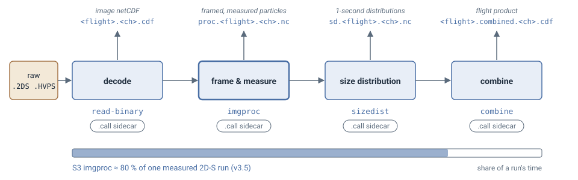

# User guide
> Pick an engine, run the quickstart, process a flight, check and read the output.

**See also** [Configuration](06-configuration.md) for the run file · [Validation](04-validation.md) for how agreement is counted · [Glossary](11-glossary.md) for cells, bins and denominators.

## Pick an engine

| Engine | Use it for | Run it with |
|---|---|---|
| **UIOOPS v3.5** (default) | any new data, any probe | `arrayprobe run <config.toml> <raw>` with `[run].engine = "3.5"`, or `run_flight.py <raw> --preset <name> --engine 3.5 --profile stock-v3.5 --tas-file <aircraft.nc> --borrowed-combine --out <dir>` |
| **SODA-2** (NCAR's IDL chain) | a second, independent processing of the same raw file | `arrayprobe soda2 run <config.toml> --out <dir> [--jobs N]` |



From Python (the entry point is documented in [the selector API](24-api-selector.md)), `arrayprobe.engine()` returns v3.5 and `arrayprobe.engine("soda2")` the SODA-2 port;
An earlier translation of UIOOPS v3.1.4 reproduced archived products and is not part of this package ([Choosing an engine](27-choosing-an-engine.md)).
`arrayprobe engines --catalogue` lists which package implements each module. `run_flight.py`
requires the engine and the preset; a v3.5 2D-S run also needs an aircraft file (`--tas-file`) and
`--borrowed-combine` (recorded in the `.call`), because no stock v3.5 release has a combine.

## Quickstart — no campaign data required

Needs a clone and the venv from [Installation](01-installation.md); the same commands are in
`examples/start_here/README.md`. `make-demo-flight` builds a synthetic raw `.2DS` file and the
aircraft airspeed file engine 3.5 needs (`base160101000000.aircraft.cdf`, a rescaled excerpt of
public ARM aircraft data). `examples/start_here/run.toml` names the engine (3.5), the `DEMO_2DS_H`
preset and the `stock-v3.5` profile, and runs decode → frame → size distribution → combine:

```bash
cd arrayprobe   # the repository root
# Windows paths throughout this page; on Linux / macOS use .venv/bin/python
mkdir -p examples/start_here/output     # Linux, macOS, PowerShell (re-runnable); in Windows cmd: if not exist examples\start_here\output mkdir examples\start_here\output
.venv/Scripts/python.exe -m arrayprobe make-demo-flight --dense examples/start_here/output/base160101000000.2DS
.venv/Scripts/python.exe -m arrayprobe run examples/start_here/run.toml examples/start_here/output/base160101000000.2DS --yes
```

The run prints `ALL DONE` and writes into `examples/start_here/output/` (untracked); the final
product is `examples/start_here/output/base160101000000.combined.H.2DS.cdf`. The TOML's paths
are relative to the TOML.

- **`--yes`** accepts the printed configuration in advance. A run with no threshold policy
  (`--regime liquid-warm`, or a `[thresholds]` section) asks first, because `stock` thresholds are
  tuned for warm liquid cloud; without a terminal it refuses. `--dry-run` prints the block and stops.
- **`--dense`** writes 12 particles per second across used bins 6–40; of 60 decoded particles,
  engine 3.5 counts **48 into used bins**. Without it, the four particles land in the first bin.
- **The demo 2D-S is sized on the 2D-S 128-bin ladder.** Stock v3.5's `sizeDist.m` has no case for
  the `DEMO` project and would fall to the HVPS table (28 bins, 0.2–30 mm). Engine 3.5 corrects
  this by default and records it in the stamp (`bins=2ds-ladder(...)`); `--protective off` keeps
  the stock table.
- **The file is large and mostly NaN, faithfully.** About 68 MB;
  its `time` dimension is **22,004 seconds**, four with data: the stem's summary time (00:00:00) predates the records
  (06:06:40), and combine pads the gap with NaN, as `combine_sizedist.m` does. Naming the file
  `base160101060640.2DS` gives a 17 KB, 4-second product; the whole-file NaN drops
  from 99.72 % to 24.32 %, counts unchanged.
- **Four rows, not five**: the SPEC reader never treats a file's last record as a primary.
- **Not validated science** ([Validation](04-validation.md)).

`examples/3_validation/01_validate_against_a_product.ipynb` compares your run with the tracked
reference (`tests/data/demo_flight_v35_*`).

## Real-data tour — a genuinely recorded flight, no campaign access needed

`ImagefileExamplePECAN` is UIOOPS's own example: 300 real CIP/PIP records from PECAN. Its terms
are undetermined, so fetch it from UIOOPS, from the repository root, with the GitHub CLI (`gh`,
authenticated) or by extracting the v3.5 tarball from the UIOOPS release page the same way:

```bash
mkdir -p UIOPS-v3.5/joefinlon-UIOPS-039be82
gh api repos/joefinlon/UIOPS/tarball/v3.5 > uiops-v3.5.tar.gz
tar -xzf uiops-v3.5.tar.gz --wildcards --strip-components=1 -C UIOPS-v3.5/joefinlon-UIOPS-039be82 \
    '*/ImagefileExamplePECAN'
```

Then decode it:

copy the run-file template
[`examples/configs/cip_uiops/cip_run.toml`](../examples/configs/cip_uiops/cip_run.toml) to
`pecan_run.toml`, keep `[run].engine = "3.5"`, set `[run].stages = "2"` (decode only) and name
the DMT format for this file, then run it from the repository root:

```bash
.venv/bin/python -m arrayprobe run pecan_run.toml UIOPS-v3.5/joefinlon-UIOPS-039be82/ImagefileExamplePECAN          # Linux, macOS
.venv\Scripts\python.exe -m arrayprobe run pecan_run.toml UIOPS-v3.5/joefinlon-UIOPS-039be82/ImagefileExamplePECAN  # Windows
```

This writes **300 records** to the decoded image file and its `.call` stamp. The tour stops there:
image processing on v3.5 needs the aircraft's airspeed, which a DMT file does not carry. For your
own flight, write it with `arrayprobe make-tas-file` and run `arrayprobe run <config.toml>`;
`examples/configs/cip_uiops/cip_run.toml` is the template.

## Process a flight

`arrayprobe run <config.toml>` runs four internal stages, chosen with `[run].stages`: decode
reads a raw file, image processing frames particles out of it, size distribution computes
one-second distributions, and combine stitches a flight's files into one product. SPEC,
DMT, PMS and SEA raw formats are supported; a new campaign is a configuration row, not a code
change ([Conventions](09-conventions.md)).

```
raw .2DS / .HVPS   decode       =>  <flight>.<ch>.nc           (image netCDF)
                   image proc.  =>  proc.<flight>.<ch>.nc      (framed and measured particles)
                   size dist.   =>  sd.<flight>.<ch>.nc        (1-second size distributions)
                   combine      =>  <flight>.combined.<ch>.cdf (the flight's product)
```

Engine 3.5 names its 2D-S/HVPS decode `<flight>.<ch>.nc`, as v3.5's `read_binary_SPEC.m` does.

**One line to run, one file to configure** — engine, fidelity profile, campaign preset and output
directory are named in the file (this example uses the start-here demo's file, which names the v3.5 engine):

```bash
.venv/Scripts/python.exe -m arrayprobe.cli run examples/start_here/run.toml examples/start_here/output/base160101000000.2DS --yes
```

Campaign constants are one preset chosen by name (`--preset`); a campaign the driver does not ship
goes in your own TOML file, passed with `--presets` ([Configuration](06-configuration.md)). The same
run, calling `scripts/run_flight.py` directly:

```bash
cd arrayprobe   # the repository root
.venv/Scripts/python.exe scripts/run_flight.py --preset DEMO_2DS_H --engine 3.5 --profile stock-v3.5 --tas-source auto --regime liquid-warm --yes ../<flight>*.2DS
```

This runs the v3.5 engine on 2D-S files with the shipped demo preset (`DEMO_2DS_H`); name your own campaign's preset instead; `--tas-source auto` supplies the aircraft airspeed a v3.5 2D-S run needs. For your own data, see [Pick an engine](#pick-an-engine).
The driver decodes each raw file, runs `imgProc_sm` and `sizeDist`, combines, and writes a `.call`
sidecar per output recording how it was invoked. `--stages 34` skips decoding; `--diode-corrected`
writes a confirmed stuck-diode mask to a separate file. `--jobs 2` runs two files at once;
`--s2-jobs 6` splits one large file's decode (a dense 157 MB file: 498 s → 153 s). Both default to
serial and live in the **port**, not the [enhancements](05-enhancements.md), because they move no
written byte. `--tas-ratio on` (engine 3.5, needs `--tas-source` or `--tas-file`) works with
`--s2-jobs` and equals the serial decode. The driver checks every input is readable before stage 2
(exit 1 if not).

**Stray-pixel correction (engine 3.5, on by default).** UIOOPS sizes an image as a whole, so a particle plus a few far-off stray pixels is sized too large. Engine 3.5 removes groups of at most 2 pixels lying more than 8 empty diodes from a single main piece of at least 9 pixels, sizes the main piece alone and writes each image's removed count to `image_stray_pixels_removed`. Turn it off with `--stray-pixel off` or `[enhancements] stray_pixel_fix = false` (the command line wins); the `.call` stamp records `stray_pixel=on:g8,n2,m9` or `stray_pixel=off`. Worked examples: `examples/5_data_quality/04_stray_pixel_images.ipynb`.

## Process a flight with SODA-2

`arrayprobe soda2 run` reads a config with `[run].engine = "soda2"` and a `[soda2]` table of
SODA-2's `op` fields under their IDL names (`fn` the raw file, `outdir`, `date`, `starttime`,
`stoptime`, `probetype`, `res`, `endbins`, …); a complete table is on
[Migrating from SODA-2](29-migrating-from-soda2.md).

```bash
python -m arrayprobe soda2 run soda2.toml --out soda2_out
python -m arrayprobe soda2 run soda2.toml --out soda2_out --jobs 4
python -m arrayprobe soda2 enhancements
```

It writes SODA-2's per-particle files (CSV and netCDF) and a `<stem>.pbp.call` sidecar;
`asciipsdfile = 1` adds SODA-2's ASCII size-distribution `.txt`. `--jobs N` splits the buffer loop
byte-identically to serial and exits 2 where it cannot (`stuckbits`, `activetimefrommissed`,
more than one raw file); `--jit` is a byte-identical speed-up. With `arrayprobe-soda2-enhancements`
installed, corrections resolved ON are applied and recorded in the sidecar. Exit 2 for a config it
cannot run, 1 when the driver returns no data ([From a SODA-2 batch script](30-from-a-soda2-batch-script.md)).

## Or drive each stage

`combine` is a subcommand. Decode, image processing and the size distribution take choices a flag
line cannot carry (software string, airspeed series, reject thresholds, output switches), so they
run as `arrayprobe run <config.toml>` with `[run].engine = "3.5"` and `[run].stages` set to `"2"`,
`"3"` or `"4"` (`"234"` for all three; `examples/start_here/run.toml` is the template):

```bash
python -m arrayprobe.cli combine sd.H.nc base160906064017.combined.H.2DS.cdf --flight-date 20160906 --summary-time 16_09_06_06_40_17 --engine 3.5 --borrowed-combine
```

- The chunking and the `d_choice` and `sa_method` choices (**they change the science**, [Configuration](06-configuration.md)) come from the preset the run names.
- `combine`: `--summary-time` is the summary file's `YY_MM_DD_HH_MM_SS` basename; on `--engine 3.5`,
  `--borrowed-combine` is required.
- `intarr-threshold` turns a `proc` file into the optional inter-arrival threshold file `sizedist`
  takes as its twelfth argument.

Which enhancements act where: [Enhancements by stage](25-enhancements-by-stage.md). Arguments
that matter more than they look:

- **The twelfth `sizeDist` argument.** Any threshold file — *even one that does not exist* —
  enables shattering removal on the per-probe default; none skips it and accepts ~58 % more
  particles. The `.call` sidecar records which.
- **`ia_thresh_type`**: `0` per-probe default, `1` the file's per-second values, `2` its
  flight-wide value.
- **Diode masks** are off by default; `--diode-corrected` writes a separate file.
- **Shattering reacceptance** scans only each set's first event at two of v3.5's three
  reacceptance sites (a [finding](07-findings.md)).

## Check the output

```bash
.venv/Scripts/python.exe -m arrayprobe reprocess examples/start_here/output/sd.base160101000000.H.nc --preset DEMO_2DS_H
```

`reprocess` re-runs a stage under its `.call` sidecar's configuration and diffs: exit 0 and
`IDENTICAL`, or the first disagreement; no reference product needed. Add `--tas-file` for a `proc`
product whose stamp names one; an `sd` product refuses it, because stage 4 never reads it.

```python
import arrayprobe
result = arrayprobe.compare_to_product("combined.cdf", "reference.cdf")
```

This compares a combined product with an archived, MATLAB-written one under [both
denominators](04-validation.md); `examples/3_validation/01_validate_against_a_product.ipynb#validate-your-own-run` walks through it for two
files you supply.

**Checking raw files before processing.** `arrayprobe inventory <dir> --out <stem> [--format spec|dmt|pms_2d]` reads the raw bytes of every file in a directory (or one file) and writes `<stem>.json` and `<stem>.csv`, one row per file, so empty and truncated files are found before a long run. It computes no product and changes nothing. Without `--format` the record format is guessed per file.

**Sharing a product with its provenance.** `arrayprobe attributed <source> [out]` writes a second file beside a faithful product, carrying the same values, the whole `.call` sidecar and a sourced unit on every variable; the faithful product is opened read-only. With `--layout particles` it instead reads a `proc` (per-particle) file and writes one Parquet table, one row per particle (default `<source>.particles.parquet`); this needs the `[parquet]` extra. `--layout dimensions` (the default) writes the netCDF sibling.

## Reading the output

The `sd` file carries `units` on every variable ([Conventions and terms](09-conventions.md)).
The combined product has none, nor global attributes, because `combine_sizedist.m` writes none:

| Variable | Dimensions | Units | Note |
|---|---|---|---|
| `Time Vector` | time | **MATLAB datenum** (days since year 0) | `736331.0` is the first second of 2016-01-02; the `sd` file's `time` is HHMMSS |
| `Bin Minimum`, `Bin Maximum`, `Bin Midpoints`, `Bin Width` | bin_count | **millimetres** | |
| `Counts` | time × bin_count | count | particles accepted per bin per second |
| `Size Distribution cm-3` | time × bin_count | **cm⁻⁴** | per unit size, despite MATLAB's name |
| `Number Concentration cm-3` | time | cm⁻³ | |
| `Mean Area Ratio` | time × bin_count | dimensionless | |
| `Reject Ratio` | time | dimensionless | |
| `files_stitched` | *(a dimension)* | — | raw files in the product |

Bins 1–5 are unused by convention (bins 6–128). Raw contracts a Python caller meets (a decode's
last record, three-valued `touching_edge`, the terminator-less `.MK.csv`) are in
[Conventions and terms](09-conventions.md#preserved-bugs); `arrayprobe.friendly`
([API](31-api-friendly.md)) re-views each without new computation.
