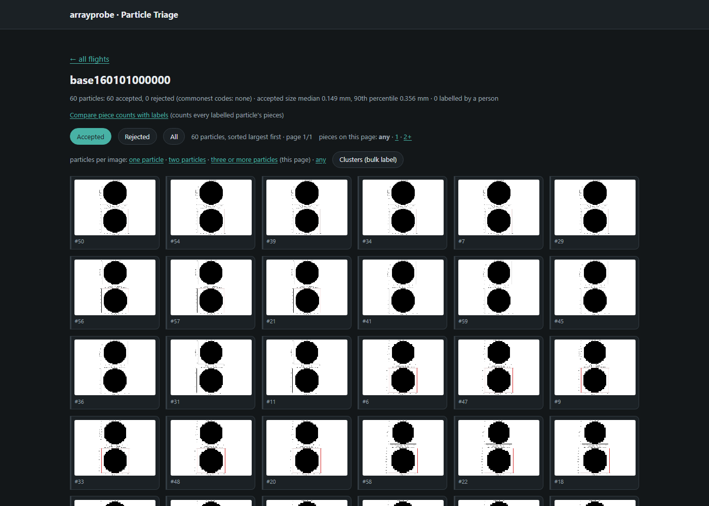

# Visualisation and triage
> An optical array probe records each cloud particle as a small black-and-white shadow image. This page shows how to look at those images, and at what the processing decided about each one.

**In short:** draw any particle, write a whole flight's particles to disk as a gallery, review and label particles in a local web viewer, and plot the size distributions a run produced. None of this changes a computed number.

**See also** [User guide](02-user-guide.md) · [Enhancements](05-enhancements.md) for the clustering that feeds bulk labelling.

| What you can look at | Why | Tool |
|---|---|---|
| One particle's image | check what the probe actually saw | `arrayprobe.render` |
| Every particle in a flight, filed by second | browse a whole flight with no extra tooling | `arrayprobe gallery` |
| Particles beside the numbers computed for them, with labels | judge whether the processing kept the right ones | `arrayprobe triage` |
| Size distributions | the science product of a run | the `sd` file, read with `netCDF4` |

Every section below runs on the dense demo flight that the [Quickstart](02-user-guide.md) writes.
`examples/1_getting_started/05_triage_and_gallery.ipynb` runs each step with its output shown.

## See the particles in a flight

`arrayprobe.render` rebuilds any particle's image from the decoded file and the processed (`proc`)
file — as a single image, a contact sheet or a self-contained HTML gallery.

```python
import netCDF4
from arrayprobe.render import reconstruct_particle_image

with netCDF4.Dataset("base160906064403.H.cdf") as img, \
     netCDF4.Dataset("proc.base160906064403.H.nc") as proc:
    silhouette = reconstruct_particle_image(img, proc, particle_index=1234)
```

## Make a gallery

```bash
cd arrayprobe   # the repository root
# Windows paths; on Linux / macOS use .venv/bin/python
.venv/Scripts/python.exe -m arrayprobe gallery \
    --decoded-dir examples/start_here/output --flight base160101000000.H \
    --out galleries --classes accepted rejected unsure
```

You get `<flight>/<HHMMSS>/{accepted,rejected,unsure}/`, one folder per second, so a second's
whole population opens in any file browser, plus paged index pages per flight and per second.
An interrupted run resumes: images already on disk are skipped. Nothing extra is installed.
On one full 2017 flight it wrote 436,983 images over 2,498 seconds in about 37 minutes.

`unsure` holds only particles a person reviewed and could not decide; an unreviewed particle is
filed by what the processing decided.

## Review and label particles

### The triage server

```bash
cd arrayprobe   # the repository root
.venv/Scripts/python.exe -m arrayprobe triage --decoded-dir examples/start_here/output \
    --port 8765 --reviewer YOUR_NAME --queue-file review.json
```

Open `http://127.0.0.1:8765/`, click the flight, then a particle.



- **Label** each particle `artifact`, `real`, `mixed` (more than one thing in the image) or
  `unsure`, by mouse or keyboard: `a`/`r`/`t`/`u`, `p`/`n` or the arrow keys to move, `Esc` to
  leave a comment box. A free-text comment can be saved with each particle.
- **Labels need a reviewer**: `--reviewer` or `ARRAYPROBE_REVIEWER`. Without one the viewer opens
  but refuses every save.
- **Labels are plain JSON**, one file per flight in `<decoded-dir>/triage_verdicts/`, keyed by
  particle index, so a review pass is inspectable and revertible.
- **Codes are spelled out**: habit letters, reject codes and property names appear in words, and
  the image is drawn at true aspect with both axes in micrometres.
- **Work a queue** with `--queue-file`: an ordered list of particles with progress and
  auto-advance, for one review pass.

### What `--decoded-dir` must contain

A run's `--out` folder, still holding both files for each flight: `proc.<flight>.<channel>.nc`
and the decoded image file beside it (`<flight>.<channel>.nc`). The viewer draws the images; the
`proc` file says which particle to draw. If the decoded images were deleted to free disk, each
flight reads `no matching raw/image file found` — expected, not a failed run.

### Optional habit field

A verdict can carry an optional `habit` letter (the Schima et al. 2024 classes the v3.5 engine
writes). The particle page offers the habit buttons for a particle labelled ice or two
particles, each with the word from the product's own `holroyd_habit` description. Records
without one load unchanged.

### Check how consistent the labels are

```bash
.venv/Scripts/python.exe -m arrayprobe triage-recheck --decoded-dir DIR --flight F --out recheck.json
.venv/Scripts/python.exe -m arrayprobe triage-agreement --decoded-dir DIR --flight F
```

The first draws a seeded sample of already-labelled particles into a blind queue; label it with
`--queue-file recheck.json`. The second prints the agreement, Cohen's kappa and the confusion
matrix between the two passes.

### Compare two processing packages on the same image

Run the UIOOPS and SODA-2 engines on the same raw file and every disagreement between them is a
decision about the same image. Build review queues where they disagree, label them in the viewer,
then export the labels:

```bash
.venv/Scripts/python.exe -m arrayprobe triage --decoded-dir DIR --queue-file queues.json --reviewer YOUR_NAME
.venv/Scripts/python.exe scripts/export_human_verdicts.py --decoded-dir DIR
```

A worked result is the Same Image, Two Verdicts comparison.
The full protocol is in `docs/developer/LABELLING_PROTOCOL.md`.

## Plot a size distribution

A run's `sd.<flight>.<channel>.nc` file holds the size distribution per second. Read it with
`netCDF4` and plot it with any library; `examples/1_getting_started/02_quickstart.ipynb` plots a
flight's size distribution, and `examples/1_getting_started/06_read_products.ipynb` opens the
`proc` and `sd` files and names their variables. How each number in that file is
built: [How a size distribution is built](22-how-a-size-distribution-is-built.md).
