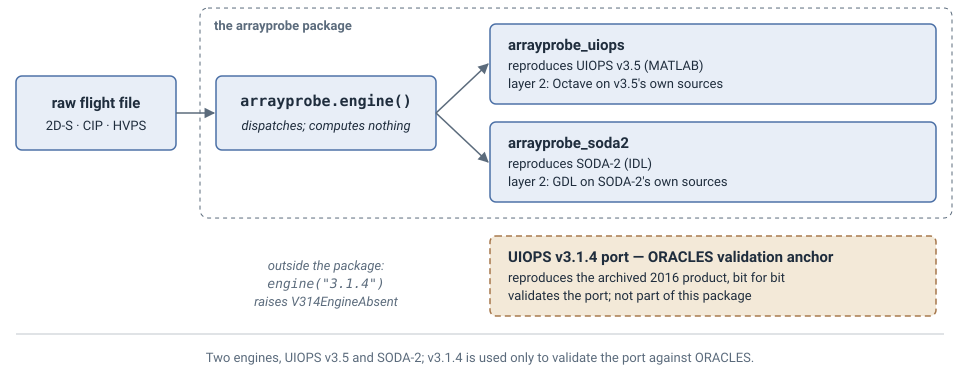

# Choosing an engine
> Two engines, UIOOPS v3.5 and SODA-2, plus optional corrections packages: which one answers your question, decided by what you need to cite.

The engines are not alternatives picked by taste: each answers a different question. The
side-by-side comparison — validation layers, output formats, thresholds, configuration — is
in [the developer documentation](developer/); this page is the decision.

**See also** [Why reproduce the original first](26-why-reproduce-first.md) · [Which enhancements apply to which engine](23-enhancements-by-engine.md) · [Configuration](06-configuration.md)



The package carries two engines on equal footing: **UIOOPS v3.5** and **SODA-2**, each a port of
its upstream's own source and each validated against that source. An earlier translation of UIOOPS v3.1.4
reproduced archived products and is not part of this package.

## One entry point

`arrayprobe.engine()` is the selector every schematic on this site draws — one call reaching both
engines, dispatching and computing nothing:

```python
import arrayprobe

eng = arrayprobe.engine()           # v3.5 -- the default
eng = arrayprobe.engine("soda2")    # the SODA-2 lineage
```

`uiops.engine()` is the narrower selector for *which UIOOPS release*, and refuses SODA-2 because
SODA-2 is not an answer to that question. `.validation` on either result states what that engine's
numbers rest on.

## Start from the question

| You want to… | Use | What you can cite |
|---|---|---|
| process new data with UIOOPS | the **UIOOPS v3.5 engine** (`arrayprobe.engine()` or `uiops.engine()`) | equivalence to Octave running v3.5's own MATLAB source |
| process new data with SODA-2 | the **SODA-2 engine** (`arrayprobe.engine("soda2")`, or `arrayprobe_soda2` directly) | equivalence to GDL running NCAR's own IDL source |
| compare the two processing chains on the same data | both engines, then the hollow-particle check below | each engine's own validation |
| apply corrections the UIOOPS developers have not made | the UIOOPS engine plus the **enhancements** package, where the correction applies to it | the correction's design document, and a comparison of its output with the correction off and on |

## Which to cite

`arrayprobe.engine()` with no argument returns UIOOPS v3.5 because a call needs a default, not
because one engine outranks the other. A paper should say which engine it used and why.

`arrayprobe engines` prints this choice and the command for each engine; `--catalogue` adds, per
module, which package implements what for a given UIOOPS version and why.

## How to run each one

```bash
arrayprobe engines --catalogue
arrayprobe make-demo-flight --dense --with-config demo/base160101000000.2DS
arrayprobe run demo/run.toml demo/base160101000000.2DS --yes
```

- **v3.5, whole flight:** `arrayprobe run <config.toml>` with `[run].engine = "3.5"` and
  `[fidelity].profile = "stock-v3.5"`. The configuration above is the tracked demo reference's and
  the one a new user should start from: nothing in it is campaign-specific.
- **One stage at a time:** `[run].stages` names the stages a run performs, on v3.5.
- **Enhancements:** `arrayprobe run --enhancements <config.toml> <raw>` (needs
  `pip install arrayprobe-uiops-enhancements`, which also installs an equivalent
  `arrayprobe run --enhancements`) runs the chosen engine, then
  applies the corrections that resolve for that engine to copies of the outputs, never touching
  the port's own files.
- **SODA-2:** `arrayprobe soda2 run <config.toml>` — see [Migrating from SODA-2](29-migrating-from-soda2.md).

## Corrections engine 3.5 applies by default

<!-- default-on:begin -->
| Engine | Correction | On by default for | Turn it off |
|---|---|---|---|
| 3.5 | `stray_pixel_fix` | every probe on engine 3.5, 2D-S/HVPS included | `--stray-pixel off`, or `[enhancements] stray_pixel_fix = false` |
| 3.5 | `ncar_2dc_timing_fix` | 2DC/2DP | `--ncar-2dc-timing off`, or `[enhancements] ncar_2dc_timing_fix = false` |
| 3.5 | `bin_table_fix` | a 2D-S that falls to v3.5's HVPS bin table, when the run names no `--probe-case` | `--protective off`, or `[enhancements] bin_table_fix = false` |
| 3.5 | particle-clock offset (no key; the stamp records `particle_clock_fix=<+N>s`) | probes whose particle clock is off the airspeed clock by an unambiguous offset (CIP/PIP) | `--protective off` |
| 3.5 | repeated second in the time grid, and `NaN` instead of infinity for a zero-sample-volume second (no key) | every probe on engine 3.5 | `--protective off` |
| 3.5 | `particle_time_glitch_fix` (drops the affected particles) | CIP/PIP | `--protective off`, or `[enhancements] particle_time_glitch_fix = false` |
| 3.5 | `particle_time_int8_fix` | 2DC/2DP, Fast2DC | `--protective off`, or `[enhancements] particle_time_int8_fix = false` |
| 3.5 | `tas_grid_fix` | 2DC/2DP, CIP/PIP, Fast2DC | `--protective off`, or `[enhancements] tas_grid_fix = false` |
| SODA-2 | `no_stuck_diode_fix`, `last_buffer_index_fix`, `same_time_buffer_fix`, `pbp_rejectionflag_ubyte`, `dilation_clamp_fix` | every probe | `[enhancements] <key> = false` |
<!-- default-on:end -->

Off on the ORACLES 2D-S/HVPS lineage, which reproduces an archived product. The empty-size-distribution refusal (`--accept-implausible`) changes no number and is not a correction.

Each correction is recorded in the stage's `.call` stamp. Detail, stamps and the reasoning behind
each are in [the developer documentation](developer/).

A 2D-S with no archived product defaults to `--tas-grid regular` when the run has
a `--tas-source` chain; `--tas-grid probe`, `--protective off` or `tas_grid_fix = false` keeps the
probe's own grid.

## Enhancements are per engine, and the resolver enforces it

A correction the UIOOPS developers already made in v3.5 must not be applied on top of v3.5, or the
defect is corrected twice; a correction for code found only in one campaign's modified copy of the UIOOPS MATLAB (a
variant with its own thresholds) has nothing to act on in a stock release. So which enhancement may run on which engine is declared per
module and enforced when a configuration is resolved — on v3.5 a superseded correction is left
off, and a file that names one is refused rather than silently ignored. The same declaration renders
[Which enhancements apply to which engine](23-enhancements-by-engine.md).

## When two engines disagree: check the hollow particles first

UIOOPS v3.5 divides a hollow particle's size (reject code `'H'`, a Poisson-spot image) by its
Korolev `size_factor`, 1.07-1.9, before binning it. SODA-2 bins the uncorrected circle unless
`apply_psc` is set. Where hollow particles are common, the two engines put the same particles in
different bins, and the difference looks like a missing block of data. One command, reading one
v3.5 proc file and writing nothing, says how much of a difference that can make:

```bash
arrayprobe view hollow proc.<stem>.H.nc --edges-um 55,65,75,85,95,105,115
```

(`--edges-from <combined file>` uses the product's own bins instead.) Each row is one size bin:

| column | meaning |
|---|---|
| `accepted`, `H`, `H share` | accepted particles (codes `0HhuR`, centre in) at their written size, how many are hollow, and the fraction |
| `out` | hollow particles the correction moves out of this bin (their uncorrected size is here) |
| `in` | hollow particles it moves into this bin (their corrected size is here) |
| `undivided`, `undiv/written` | the count with the correction undone, and its ratio to the written count: what an engine that does not divide would count, from sizing alone |

`accepted = undivided - out + in` in every bin. The last line is the verdict for the whole
range: **YES** when the correction changes the range's count by at least 5 % and by more than
twice its Poisson standard error (`--min-fraction` changes the 5 %). 5 % is the counting noise of
a range of 400 particles; the Poisson clause keeps a sparse range from firing. The counts are the
proc file's accepted particles, before sizeDist's area-ratio and interarrival rejects, so they are
not the product's `Counts`; the ratio is the quantity to read.

When the difference is quoted above one size (an N ratio at or above a threshold), use the
one-range form from Python:
`arrayprobe.diagnostic_views.hollow_share_at_or_above(proc_path, threshold_um)` returns the
accepted count, the hollow count and share, and `ratio_undivided_to_written` over
`[threshold_um, inf)`. Divide the measured between-engine ratio by it: a result near 1 means
hollow sizing explains the difference; what remains is something else.
Both calls run on a real proc file in the last two cells of
`examples/1_getting_started/03_choosing_an_engine.ipynb`.

To check your own data for the same divergence, run `examples/5_data_quality/07_hollow_particles.ipynb`: it counts one set of particles with and without the Korolev size factor and reports the large-bin ratio and a no-hollow control. On its demonstration data (stored outputs of section 4b) particles of 600 um and above give B/A = 1.59 (+2.0 dB), the 900-1000 um bin +7.4 dB, and the control with hollow particles removed 0 dB; its last cell runs the same check on one of your own proc files.

**Worked example: a 2D-S flight with no archived product.** SODA-2's used-bin concentration
(55-115 µm) was 1.4655 × v3.5's, against 1.1081 on the next day's flight. In one ten-minute block, v3.5 accepted
3046 particles at 55-115 µm as written and 5341 with the hollow division undone; SODA-2
accepted 4676. Of the 2808 accepted hollow particles whose uncorrected size was 55-115 µm, the correction
put 2396 below 55 µm, and that flight had almost nothing above 115 µm to move down in their place. With
the division undone, the median concentration ratio falls from 1.4655 to 1.0206. On the next day's flight about
half the used-size particles are also hollow, but particles corrected down from above 115 µm
refill the range, so its shift is smaller.

A result from `arrayprobe_soda2` cites SODA-2, in the form its author, Aaron Bansemer, provided:

> Aaron Bansemer. (2026). abansemer/soda2: v2.26.0 (Version v2.26.0) [Computer software]. Zenodo. https://doi.org/10.5281/zenodo.18331418
